# KCommit-Blog

**Astro 个人博客主题** · Markdown 写内容 · 静态上云

-C%23%20%2F%20ASP.NET-512BD4?style=flat-square&logo=csharp&logoColor=white)

目前是基于 [Astro](https://astro.build) 的个人博客**前端**主题：文章、说说、文档、分享、项目、友链星图。  
当前开箱即用形态是 **纯静态** 站。

**现状**：基本博客展示 + **本机管理端**（写文 / 导入 Markdown / 推送上线）已可用。  
**路线**：评论（Giscus）上线后，再在本仓库用 **C# / ASP.NET Core** 接后端。

> 仓库是可运行示例。正式使用前请自行更改相关配置。  
> **非商业用途**（禁止商用），详见 [LICENSE](./LICENSE)。

---

## 目录

- [内容介绍](#-内容介绍)
- [本机管理端](#-本机管理端写文--发布)
- [后续更新计划](#-后续更新计划)
- [更新记录](#-更新记录)
- [快速部署](#-快速部署版本对应111)
- [文档索引](#-文档索引)
- [License](#license)

---

## 内容介绍


| 图标  | 层级      | 说明                                        |
| --- | ------- | ----------------------------------------- |
| 🪐  | 前端      | Astro 5 · 静态输出 · Content Collections（本仓库） |
| 📝  | 内容（静态期） | `src/content/**` Markdown                 |
| ⚙️  | 配置      | `src/site.ts`（身份 / 友链 / 歌单；Giscus 预留未启用）  |
| 🖼️ | 资源      | `public/img`、`public/music`               |
| 🔌  | 读取      | `src/lib/api`：当前本地 Markdown；远程切换待后端就绪     |
| 🛠️ | 管理端     | **已实现**：本机 `admin/`（写文 / 导入 / 推送；勿挂公网）    |
| 💬  | 评论      | **未上线**（Giscus 配置位已留）                     |
| #   | 后端      | **后置**：评论与体验就绪后再上 C# / ASP.NET（本仓库）       |


### 仓库结构（简图）

```
KCommit-Blog/
├── admin/           # 🛠️  本机写稿后台（Node，仅 localhost）
├── src/
│   ├── content/     # ✍️  Markdown 内容集
│   ├── site.ts      # ⚙️  站点配置
│   ├── lib/api/     # 🔌  本地 / 远程读取
│   ├── pages/       # 路由配置
│   ├── components/
│   └── layouts/
├── public/          # 🖼️  图片、音乐、favicon
├── docs/            # 📚  开发与接口文档
├── astro.config.mjs
└── package.json
```

---

## 本机管理端（写文 / 发布）

管理端不在**Cloudflare Pages**部署，只在你电脑上跑：改本地 Markdown → 再 push 让 Pages 构建。

### 启动

```bash
npm install
npm run admin          # http://127.0.0.1:4322
```

Windows 可直接双击 **`admin/Start.bat`**（自动打开浏览器；关掉黑窗口即停止）。

前台预览仍用：`npm run dev` → http://localhost:4321

### 功能


| 功能          | 说明                                              |
| ----------- | ----------------------------------------------- |
| 管五类内容       | 文章 / 说说 / 文档 / 分享 / 项目：列表、新建、编辑、删除、草稿           |
| 导入 Markdown | 选本地已写好的 `.md`，正文与 frontmatter 自动填入，再改配置即可       |
| 配图上传        | 封面等到 `public/img/covers|shares|projects/`，路径写回 frontmatter |
| 发布上线        | 页面底部填写提交说明 → **提交并推送** → GitHub → CF Pages 自动部署 |


### 容易忽略的细节

- **只监听 `127.0.0.1`**，不要把管理端端口映射到公网
- **保存 ≠ 上线**：保存只写磁盘；线上要变必须点「提交并推送」（或自己 `git push`）
- **推送范围**：默认只提交 `src/content/**` 与 `covers|shares|projects` 配图；**正文插图**请放 `public/img/docs/...` 等并用 `/img/...` 引用，必要时自己 `git add public/img`
- **Git 凭据**：本机需已能对远程仓库 `git push`（SSH / HTTPS 登录与平时一样）
- **`site.ts` 仍手改**：名字、友链、歌单、壁纸、Giscus 等不在管理端里
- **slug = 文件名**：只能用字母数字、点、下划线、短横线；中文文件名导入后需手填 slug
- **草稿**：`draft: true` 不会进列表、也不会生成详情页路径
- **相对时间**：卡片上「昨天 / x 天前」在浏览器里按当前时间算，不是阅读时长
- **正文图片**：不要写成 `./a.png` 或盘符路径；图必须在 `public/`，Markdown 写 `/img/...`（详见 [CONTENT.md §4](./docs/CONTENT.md)）

更细的字段与目录约定见 [docs/CONTENT.md](./docs/CONTENT.md)。

---

## 后续更新计划


| 优先级 | 计划                  | 说明                                                     |
| --- | ------------------- | ------------------------------------------------------ |
| P0  | **评论上线**            | 接好 Giscus，文章页可评论                                       |
| P1  | 管理端增强               | `site.ts` 可视化、Markdown 预览等（按需）                         |
| P1  | 静态体验补全              | 文档 / 示例与评论上线同步                                         |
| P2  | **C# / ASP.NET 后端** | 本仓库新增后端工程，实现 [docs/API.md](./docs/API.md)；管理页再对接真实 API |
| P2  | 写入 / 鉴权             | 后端 CRUD + 登录后，管理页从「改本地文件」迁到服务端                         |


更细的条目见 [docs/ROADMAP.md](./docs/ROADMAP.md)。

---

## 更新记录

摘要如下，完整条目见 [docs/CHANGELOG.md](./docs/CHANGELOG.md)。


| 版本    | 日期         | 说明                           |
| ----- | ---------- | ---------------------------- |
| 1.1.1 | 2026-10-23 | 文档补充：插图约定、域名绑定说明、管理端用法       |
| 1.1.0 | 2026-10-23 | 本机管理端（写文 / 导入 / 推送）          |
| 1.0.0 | 2026-10-22 | 初版开源：Astro 静态主题；CF Pages 部署； |


---

## 快速部署（版本对应 1.1.1）

整体路径：

**Git 仓库 → Cloudflare Pages → `*.pages.dev` →（可选）自定义域名 → 回写站点 URL 与内容**

### 0. 本地试运行（可选，建议）

```bash
git clone <你的仓库地址>
cd <仓库目录>
npm install
npm run dev      # http://localhost:4321  预览站点
npm run admin    # http://127.0.0.1:4322  本机写稿
npm run build
```

- [ ] 在本地试运行时，你可以提前熟悉项目结构与配置方式
- [ ] `src/` 是站点源码；`public/` 是公开静态资源（图、音乐、favicon）
- [ ] `src/site.ts` 是网站基本配置（名字、友链、歌单、壁纸等）
- [ ] 写文章可手改 `src/content/**`，或用 `npm run admin`（见上文「本机管理端」）
- [ ] 需要 **Node.js 18+**（建议 20 / 22）；管理端推送还需要本机 Git 已登录远程

### 1. 准备代码仓库

>  提示：文档目前主要演示如何在cloudflare上搭建静态站，你首先需要有 Git 和 一个 GitHub 账号

- [ ] Fork 本仓库，或 `git clone` 后推到你自己的 GitHub / GitLab 等
- [ ] 确认默认分支有完整源码（含 `package.json`、`src/`、`public/`）
- [ ] 私有或公开仓库均可；Pages 需能访问该仓库(建议私有以保护重要数据)

### 2. 注册并进入 Cloudflare

- [ ] 打开 [Cloudflare Dashboard](https://dash.cloudflare.com/) 注册 / 登录，推荐使用Github登录，可以直接授权 Cloudflare(可能要科学上网)
- [ ] 如果不是使用 Github 登录，你还需要 **Connect Github**，左侧进入 **Workers & Pages**（或 **Compute** → **Workers & Pages**）, 选 **Create application** → **Connect Github**即可

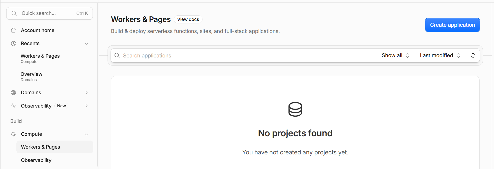
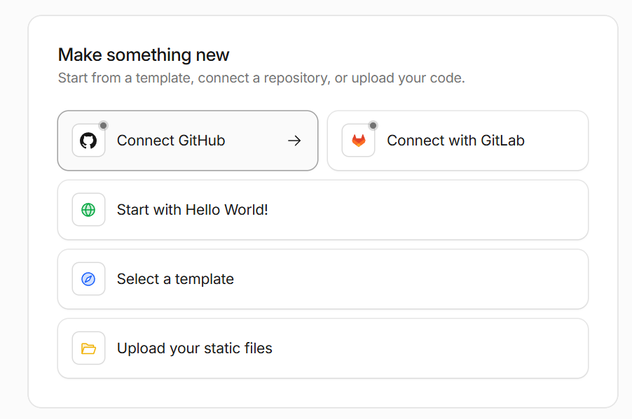

- [ ] 授权 Cloudflare 访问你的私有项目仓库，回到你的 **Github** ，点击右上角你的头像，**settings** → 左边找到 **Applications** → **Configure**

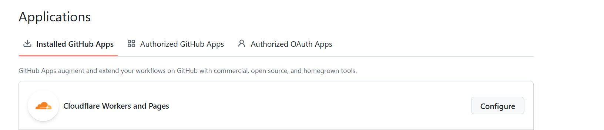

- [ ] 向下翻会看到 **Repository access**， 选择**Only select repository** → 在 **select repository** 选择你创建好的私有仓库保存即可，这样你的CF就可以读取到你的私有Blog仓库了

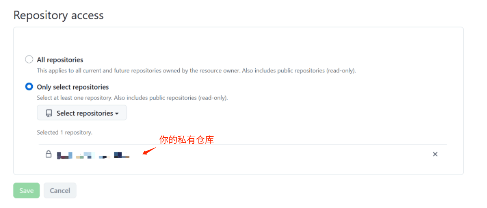

### 3. 连接仓库并创建 Pages 项目

**构建准备：**

- [ ] 回到Cloudflare，左侧进入 **Workers & Pages**（或 **Compute** → **Workers & Pages**）, 选 **Create application** → **Continue to Pages**


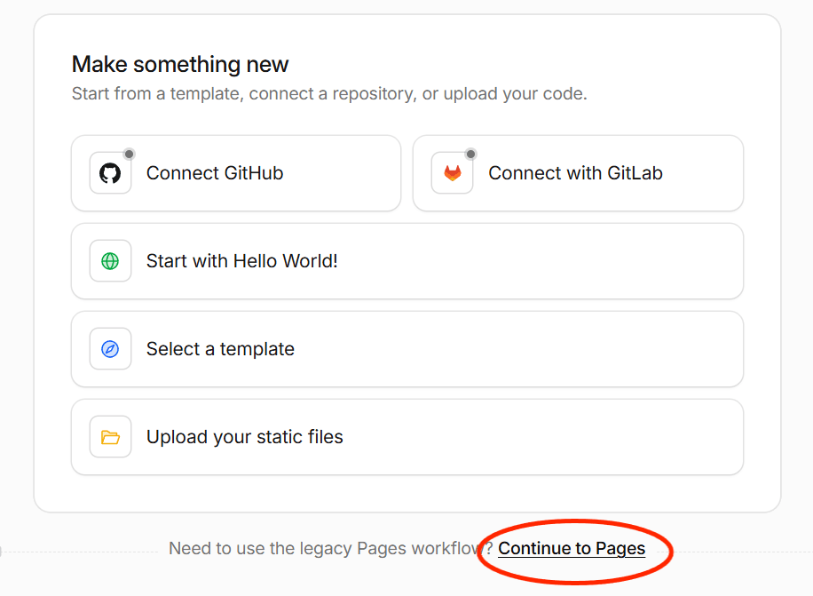

- [ ] 选择 **Import an existing Git repository**  **Get Started**

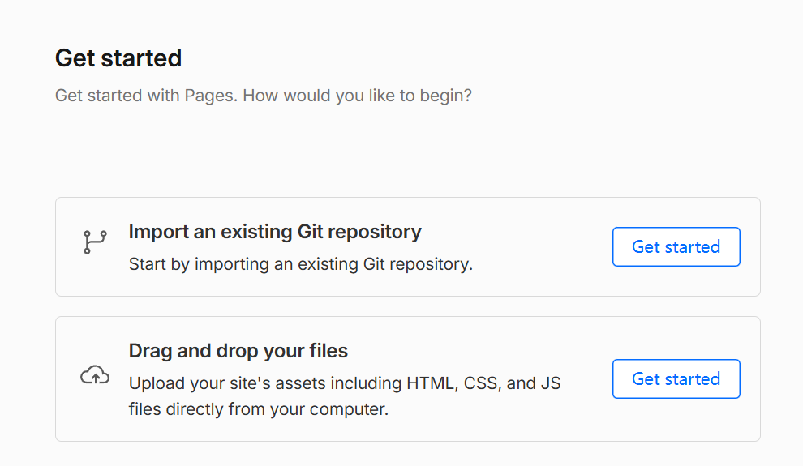

- [ ] 如果你是用Github登录，直接在**Select a repository**中选择你的博客仓库，**Begin setup**

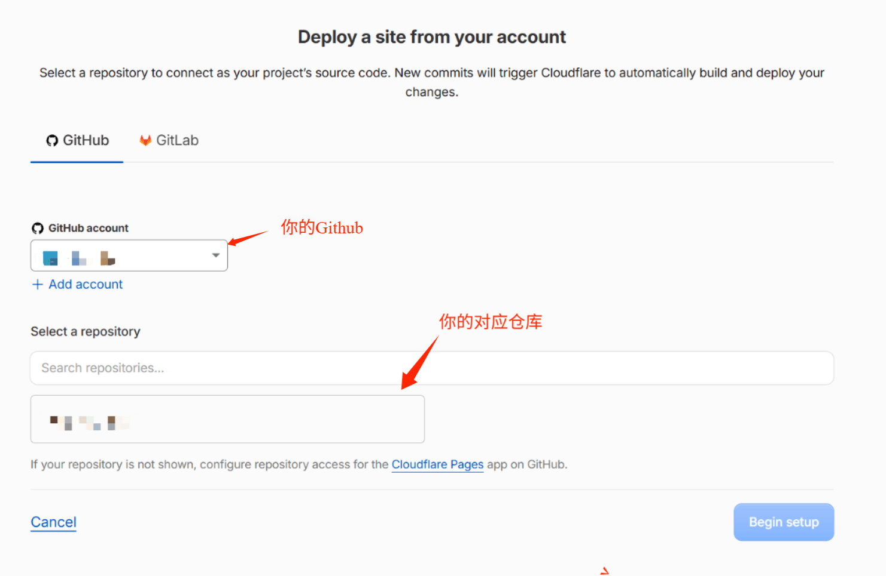

**构建设置：**

- [ ] 项目名称：自定（影响默认域名 `项目名.pages.dev`）
- [ ] 生产分支：一般选 `main` / `master`

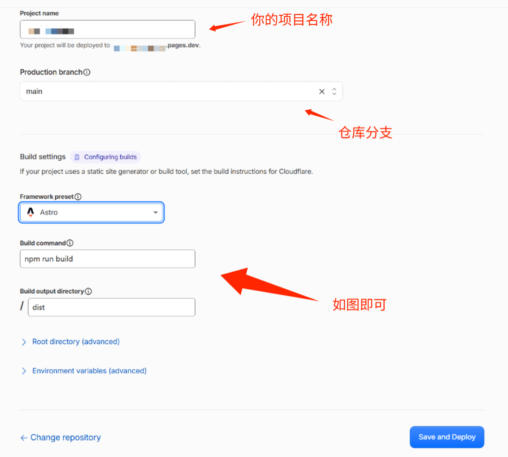


| 项    | 选 / 填                      |
| ---- | -------------------------- |
| 框架预设 | **Astro**                  |
| 构建命令 | `npm run build`            |
| 输出目录 | `dist`                     |
| Node | **18 / 20 / 22**（在项目设置里指定） |
| 环境变量 | 一般先空着                      |


- [ ] **Save and Deploy**，等构建成功，如图则表示构建成功，点击 **Continue to project**

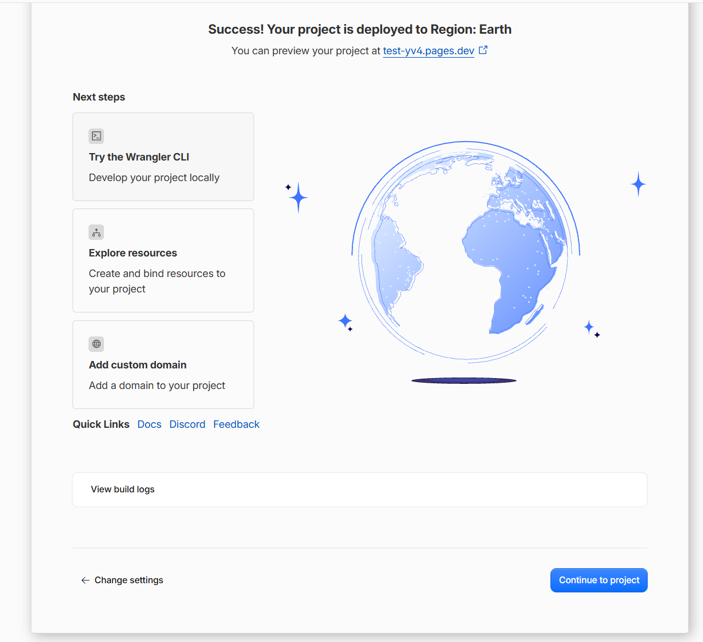

- [ ] 打开：`https://<项目名>.pages.dev`

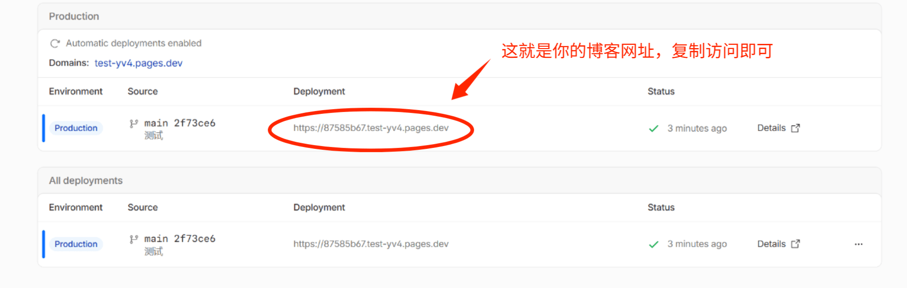

之后每次 `git push` 到生产分支（或管理端里「提交并推送」），Pages 会自动重新构建。

### 4. 免费域名（CF 会免费提供一个二级域名）

- 自动获得：`https://<项目名>.pages.dev`
- 在项目 **Custom domains** 可查看
- 如果你不想折腾自己域名，使用免费域名即可；要绑定自己的域名，见下文「绑定自己的域名」

### 5. 博客基本配置

- [ ] 基本的配置在`src/site.ts`中，由于博客的一些基本配置都是占用或者模拟，所以部署完静态站后还需要你自行进行一些配置
- [ ] 除下面示例外，也请一并检查并改成自己的：`about`（关于页）、`friends`（友链列表，**含 `friends.self` 本站 url / 名称 / 简介**）、`contact`（联系页）；示例友链、示例文章 / 项目是否删除或改写
- [ ] 首先是基本信息：

```typescript
  name: 'Your Name', //你的名儿
  githubUser: 'your-github', //你的Github地址
  email: 'you@example.com', //邮箱
  tagline: 'commit 日记', //标签名
  /** 首页个人卡片：名字旁的小字 */
  profileBio: '用 Markdown 记踩坑与复盘。Fork 后改这里的文案即可。',
  /** 首页个人卡片：头像名字下方的大字标题 */
  profileHeadline: '先跑通，再打磨。',
  description:
    '基于 Astro 的个人博客主题模板。文章、项目、友链、说说都用本地 Markdown 维护。',
```

- [ ] 自定义图片：

```typescript
  avatar: '/img/avatar.png', //你的头像
  favicon: '/favicon.png', //浏览器标签页图标；建议小图，别直接用大头像

  /** 全站背景图；换图只需改这里 */
  backgroundImage: '/img/wallpaper/static/img_1.png', //PC端背景图
  backgroundImageMobile: '/img/wallpaper/static-mobile/0001/modile.png', //移动端背景图
```

> 左侧轮播图
> 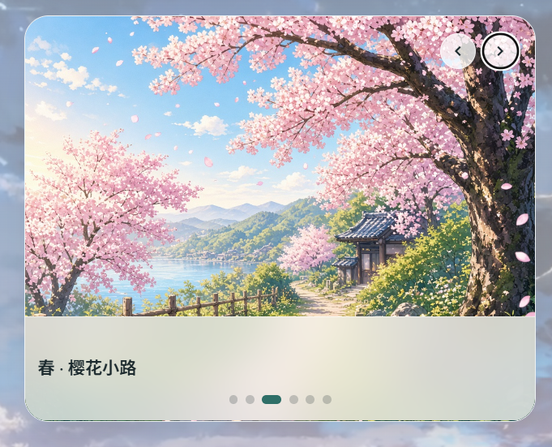

```typescript
bento: {
    featured: '/img/bento/featured.png',
    carousel: [
      {
        type: 'image' as const,
        image: '/img/bento/wall-spring.jpg', //可以随意替换
        caption: '春 · 樱花小路', //更改文字
      },
      {
        type: 'image' as const,
        image: '/img/bento/wall-summer.jpg',
        caption: '夏 · 海风与阳光',
      },
      {
        type: 'image' as const,
        image: '/img/bento/wall-autumn.jpg',
        caption: '秋 · 红叶漫路',
      },
      {
        type: 'image' as const,
        image: '/img/bento/wall-winter.jpg',
        caption: '冬 · 雪夜暖窗',
      },
    ],
  },
```

- [ ] 音乐播放器(音乐播放器是我偷懒了，需要自己准备音乐，后续会上线更好的解决方案)：

```typescript
playlist: [
    {
      title: 'LOVE PARADISE', //音乐名
      artist: '陈慧琳', //作者
      src: '/music/陈慧琳 - LOVE PARADISE.mp3', //路径
    },
  ],
```

### 6. 本地管理端(后端完成后可以提供更方便的方式)

> 管理端**不会**随 Cloudflare Pages 一起部署，只在本机运行。更完整的说明见上文 [本机管理端（写文 / 发布）](#-本机管理端写文--发布)。

静态站部署好之后，日常写文可以按下面做（不必每次手改 Markdown）：

**6.1 启动**

- [ ] 本机已在仓库根目录执行过一次 `npm install`（只需装依赖时做）
- [ ] **Windows（推荐）**：资源管理器进入仓库，双击 `admin/Start.bat`
  - 会自动打开浏览器访问 http://127.0.0.1:4322
  - 弹出的黑色命令行窗口不要关；**关掉该窗口 = 停止管理端**
  - 若窗口一闪就退出：用「在终端中打开」进仓库根目录，再执行 `npm run admin` 看报错（常见是没装 Node，或还没 `npm install`）
- [ ] **macOS / Linux / 或更习惯命令行**：

```bash
npm run admin
```

然后浏览器打开 http://127.0.0.1:4322（只监听本机）

- [ ] 另开终端需要预览前台站点时：`npm run dev` → http://localhost:4321

**6.2 写内容**

- [ ] 顶部切换类型：文章 / 说说 / 文档 / 分享 / 项目
- [ ] **新建**：填 slug（文件名）、标题等字段与正文 → **保存**（写入 `src/content/...`）
- [ ] 或 **导入 Markdown**：选本地已写好的 `.md`，核对 / 补全配置后再保存
- [ ] 需要封面时：先保存出文件，再上传图片（落到 `public/img/covers|shares|projects/`）
- [ ] 草稿勾选 `draft` 后不会出现在线上列表

**6.3 正文插图（重要）**

- [ ] 图片放到 `public/img/docs/{slug}/` 或 `public/img/posts/{slug}/` 等目录
- [ ] Markdown 里写成 ``（站点根路径，不要用 `./` 或盘符路径）
- [ ] 细节见 [docs/CONTENT.md §4](./docs/CONTENT.md)

**6.4 发布到线上**

- [ ] 页面底部「发布上线」查看待提交文件
- [ ] 填写提交说明 → **提交并推送**
- [ ] 等 Cloudflare Pages 构建完成，刷新你的站点查看
- [ ] 若正文插图不在 covers/shares/projects 目录：一键发布可能带不上，请自行：

```bash
git add src/content public/img
git commit -m "更新内容与配图"
git push
```

**6.5 使用注意**

- [ ] 保存只改本地；不推送则线上不变
- [ ] 本机 Git 需已能对远程 `git push`（凭据与平时相同）
- [ ] `site.ts`（名字、友链、歌单、壁纸等）仍用手改
- [ ] 不要把 `4322` 端口映射到公网

### 7. 绑定自己的域名（可选）

**域名已在 Cloudflare 时（更常见、也更简单）**：多数情况**不必**去注册商改 NS。在 Pages 项目里打开 **Custom domains** → 添加你的域名（如 `www.你的域名` / `你的域名`），按提示确认 DNS 即可；目标一般是 `<项目名>.pages.dev`。下面 7.2 起是「把整站 DNS 迁到 Cloudflare」的完整示例（截图以作者环境为例，NS 主机名以你控制台显示为准，勿照抄）。

**7.1 有域名**

- [ ] 域名已在注册商购买（Cloudflare / Namecheap / 腾讯云等）
- [ ] 若域名**还不在** Cloudflare：可将 DNS 托管到 Cloudflare（添加站点 → 改 NS），或按 Pages 提示在原 DNS 加 **CNAME**（常见：`www` → `<项目名>.pages.dev`；根域按 CF 说明处理）

**7.2 在 Workers & Pages 里挂上**

- [ ] 在 Workers & Pages 选择项目并打开 → **Custom domains** → **Set up a custom domain**
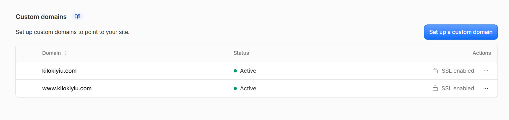
- [ ] 输入域名，将以本人注册的域名(www.kilokiyiu.com)为例 → 按提示验证；若引导迁移 DNS，可选左边 **Begin DNS transfer**，改用 CF 解析（域名本就在 CF 时可跳过迁移，直接添加自定义域）
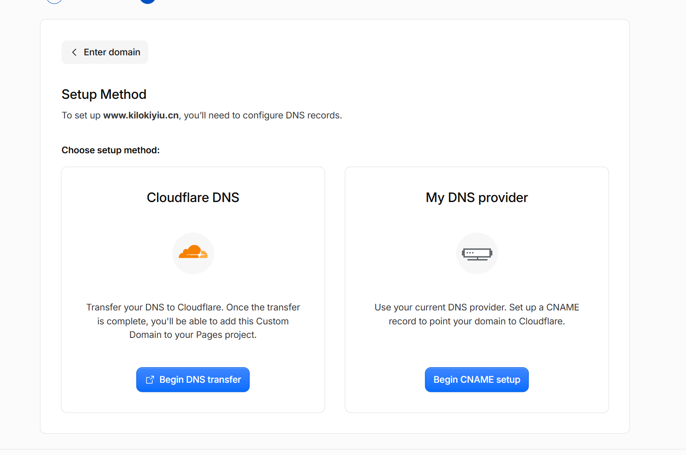
- [ ] 选择 **Connect a domain**
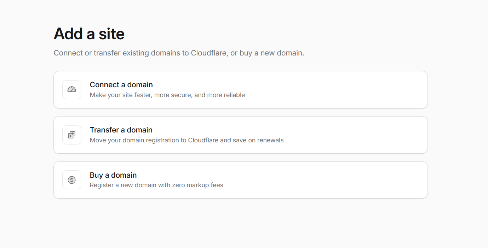
- [ ] 如图，确定你的域名名称(**Domain name**) ，下面的选项默认即可，如果存在疑问可以自行判断开启
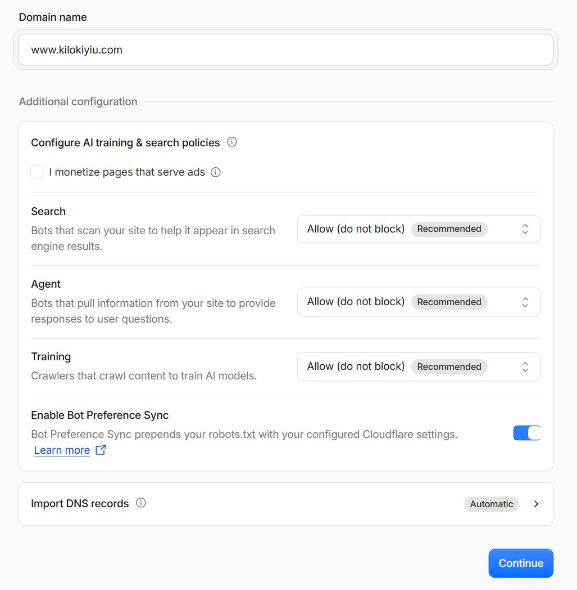
- [ ] 选择**free**方案即可
- [ ] 这里如图填写，域名以你实际的项目域名为准
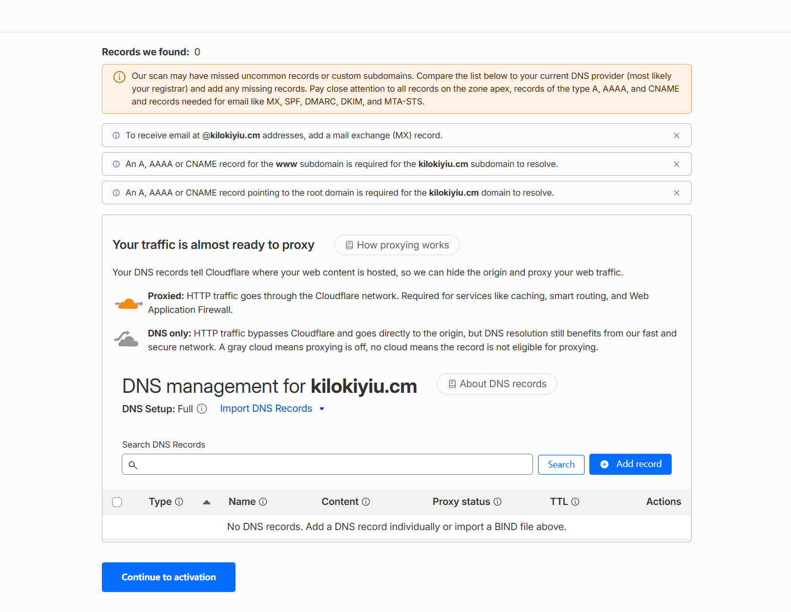
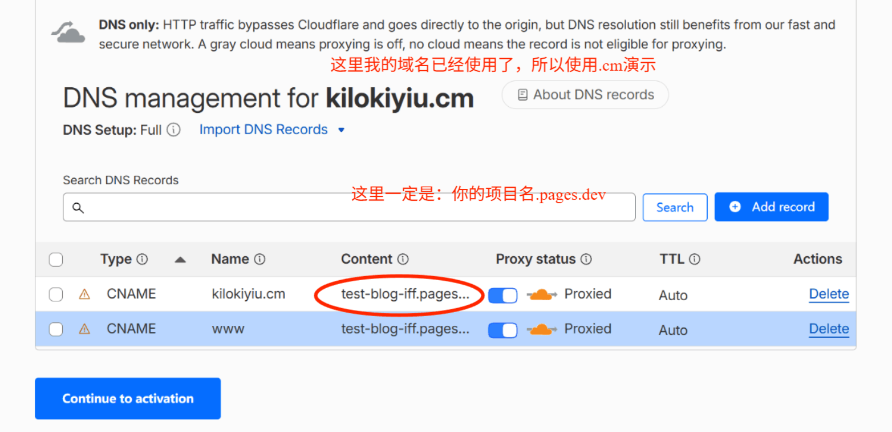
- [ ] 填完后点击**Continue to activation**会出现两台 Cloudflare 名称服务器（示例如下圈出的内容；**以你页面上显示的为准，每人不同，勿照抄**）
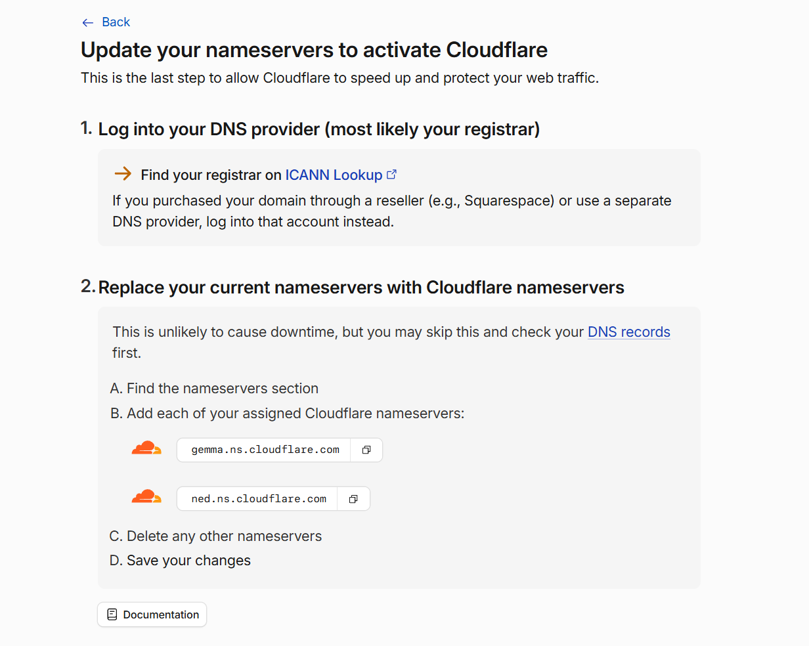
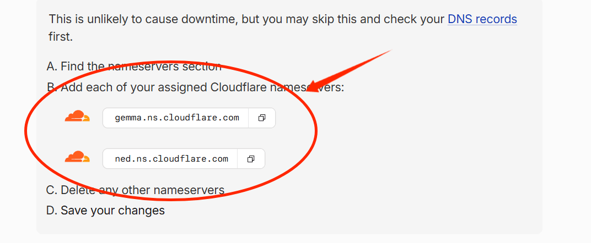
打开你的域名供应商（例如腾讯云），在域名的 DNS 解析里点击**修改 DNS 服务器**
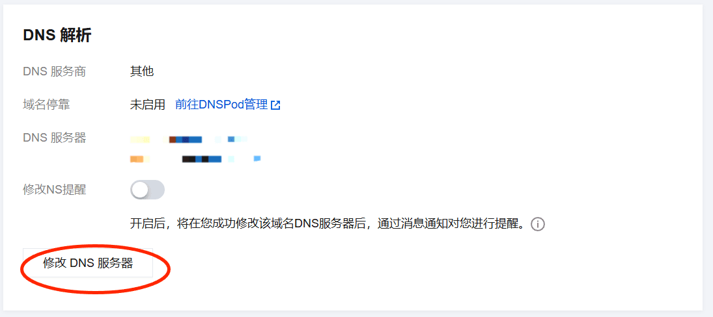
选择**使用非腾讯云 DNS**（或其它注册商的「自定义 DNS」），把控制台给出的**两台 NS**填入并提交
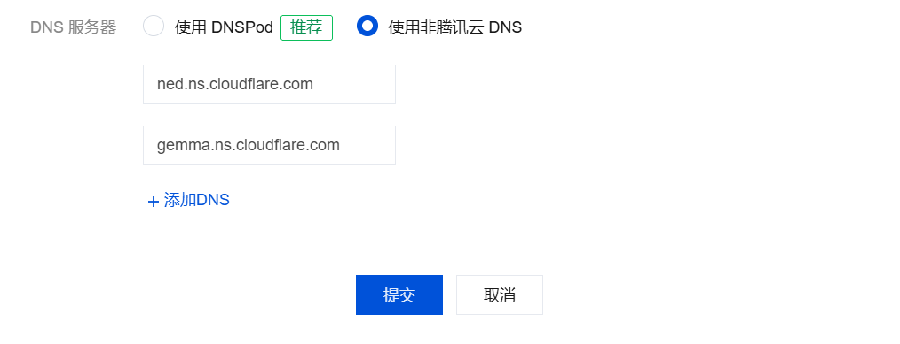
- [ ] 最后回到 Cloudflare，点击 **I updated my nameservers**，等待解析生效后，用 `https://www.你的域名` 或 `https://你的域名` 访问博客


**7.3 回写到仓库（重要）**

- [ ] `astro.config.mjs` → `site: 'https://你的域名'`
- [ ] `public/robots.txt` → Sitemap 同一域名
- [ ] `src/site.ts` → 友链「本站」url 等  

**7.4 如果你暂时还没有域名**
- [ ] 可以在腾讯云，网易云，Cloudflare购买专属域名哦，如果你不想折腾使用免费域名也无伤大雅

然后 push，触发重新部署。

### 8. 内容与资源（上线前）

- [ ] `src/site.ts` — 名字、邮箱、`about` / `friends`（含本站 url）/ `contact`、歌单、壁纸路径
- [ ] 示例友链、`src/content/` 里的示例文章 / 文档 / 项目：删掉、改写，或设 `draft: true`
- [ ] `public/img/` — 头像、封面、项目图、壁纸（路径要和 `site.ts` / frontmatter 一致）
- [ ] `src/content/` — 换成自己的 Markdown；也可用管理端导入
- [ ] （可选）打开 Giscus：填 `site.giscus` 并把 `enabled` 设为 `true`
- [ ] （可选）`public/music/` 自备音频，并在 `site.playlist` 登记
- [ ] 确认 `astro.config.mjs` 的 `site` 已是你的最终域名（影响 RSS / Sitemap / OG）

### 9. 常见卡点


| 现象                | 先查                                                                        |
| ----------------- | ------------------------------------------------------------------------- |
| 构建失败              | 构建命令 / 输出目录；Node 版本                                                       |
| 页面 404 / 样式丢      | 输出目录是否为 `dist`                                                            |
| 自定义域打不开           | DNS 是否指到 Pages；SSL 是否 Active                                              |
| 分享链接 / Sitemap 不对 | `site` 与 `robots.txt` 是否已改最终域名                                            |
| 管理端打不开            | 是否双击了 `admin/Start.bat` 或执行了 `npm run admin`；是否已 `npm install`；4322 是否被占用 |
| 管理端推送失败           | 本机 `git push` 是否本就能成功；远程与凭据是否配置好                                          |
| 推了但线上没变           | Pages 构建日志是否成功；是否推到了生产分支；内容是否 `draft: true`                               |
| 文档 / 文章里图片裂开      | 图是否在 `public/img/...`；Markdown 是否写成 `/img/...`；图是否已 commit 并部署            |


---

## 文档索引(后续文档补充中)


| 文档                                           | 说明                                |
| -------------------------------------------- | --------------------------------- |
| [docs/CONTENT.md](./docs/CONTENT.md)         | 📌 重要内容说明：目录约定、frontmatter、图片与配置  |
| [docs/DEVELOPMENT.md](./docs/DEVELOPMENT.md) | 🛠️ 二次开发：目录职责、改主题、扩展页面、注意事项       |
| [docs/API.md](./docs/API.md)                 | 🔌 内容 API 契约（供 C# / ASP.NET 后端实现） |
| [docs/ROADMAP.md](./docs/ROADMAP.md)         | 🗺️ 后续更新计划全文                      |
| [docs/CHANGELOG.md](./docs/CHANGELOG.md)     | 📋 更新记录全文                         |


---

## License

[PolyForm Noncommercial 1.0.0](./LICENSE) © Kilokiyiu  

**允许**个人学习、研究、爱好与其它非商业用途；**禁止**将本软件用于任何商业目的。商用请联系版权方授权。